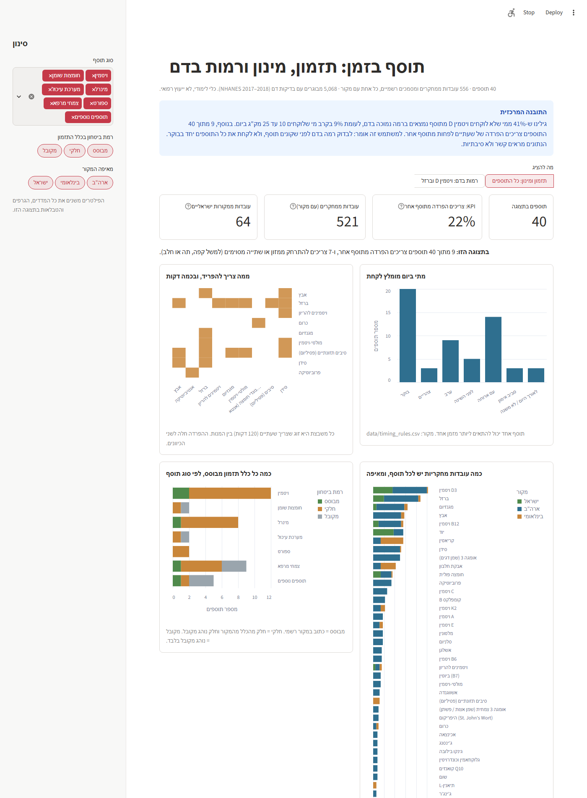

# תוסף בזמן (TosafBazman)

**לוח זמנים אישי לנטילת תוספי תזונה: מתי לקחת כל תוסף, עם מה, ומה להפריד, ומודל שמעריך למי כדאי לבדוק חוסר.**

🔗 **אב-טיפוס חי:** [תוסף בזמן, אפליקציה ראשונית](https://claude.ai/artifact/XW47W1rhrcCKfZRuuHZBdY)
(קובץ המקור נמצא בריפו: [`prototype/tosaf-bazman.html`](prototype/tosaf-bazman.html))

> ⚠️ פרויקט סטודנטים במסגרת הקורס "וייב קודינג עם קלוד", אוניברסיטת אריאל, סמסטר א׳ תשפ״ז. הכלי לא מחליף ייעוץ רפואי או ייעוץ של דיאטנית.

---

## משפט הפרויקט

**סטודנטים ומתאמנים צעירים שנוטלים כמה תוספי תזונה** סובלים מ**בלבול לגבי מתי ועם מה לקחת כל תוסף, ומשילובים שפוגעים בספיגה**, ואנחנו נבנה **אפליקציה שמייצרת לוח זמנים אישי לנטילת התוספים ומעריכה ממה כדאי לבדוק חוסר**, שמשתמשת ב**נתוני NHANES על שימוש בתוספים ועל רמות ויטמינים בדם, ובמודל סיווג (ML)**.

## הבעיה

כ-45% מהמשתתפים בסקר NHANES 2017–2018 דיווחו שנטלו תוסף תזונה בחודש האחרון, ורבים נוטלים כמה תוספים במקביל.
לתזמון יש השפעה: ברזל נספג טוב יותר על קיבה ריקה ועם ויטמין C, אבל סידן, אבץ ומגנזיום מפריעים לספיגתו. ויטמין D צריך ארוחה שיש בה שומן.
רוב האנשים לא יודעים את הכללים האלה. הם לוקחים את כל התוספים יחד בבוקר, או שוכחים מנות.
בנוסף, אנשים מתחילים לקחת תוספים "ליתר ביטחון" בלי לדעת אם יש להם חוסר, ומפספסים חוסרים אמיתיים, למשל ויטמין D בחורף או ברזל בתזונה צמחונית.
כלי דיגיטלי מתאים כאן: הוא מחשב לוח זמנים לפי שעות היום של המשתמש, מזכיר, עוקב אחרי נטילה, ומשתמש בנתונים כדי להעריך סיכון.

## פרסונה ותרחיש

**נועה, 22, סטודנטית לתזונה, צמחונית, מתאמנת בחדר כושר 4 פעמים בשבוע.**
בבדיקת דם אחרונה נמצאו אצלה פריטין נמוך וויטמין D נמוך. הרופאה המליצה על ברזל וויטמין D, והיא כבר לוקחת קריאטין למטרות אימון ומגנזיום כדי לישון טוב יותר.

**התרחיש:** ביום ראשון בבוקר נועה פותחת את "תוסף בזמן", מזינה קימה ב-07:00, ארוחות ב-08:30, 13:30 ו-19:30, אימון ב-17:00 ושינה ב-23:30, ומסמנת ארבעה תוספים, לכל אחד עם הסיבה שלו.
האפליקציה מציגה לה לוח: ברזל עם ויטמין C ב-07:30 על קיבה ריקה, ויטמין D עם ארוחת הצהריים, קריאטין אחרי האימון, ומגנזיום ב-22:30, שעתיים לפחות אחרי הברזל.
לאורך היום היא מסמנת כל מנה שלקחה. בסוף השבוע היא ממלאת את שאלון "כדאי לי לבדוק חוסר?" ומגלה שהסיכון שלה לחוסר ב-B12 בינוני, אז היא מבקשת בדיקה בפעם הבאה.

## מקור הנתונים

### 1. NHANES 2017–2018 (CDC): המקור המרכזי למודל

סקר הבריאות והתזונה הלאומי של ארה״ב. כל הקבצים להורדה ישירה בפורמט `XPT` (נקרא ב-`pandas.read_sas`), ומתחברים זה לזה דרך מזהה המשתתף `SEQN`.
דף הנתונים: https://wwwn.cdc.gov/nchs/nhanes/search/datapage.aspx?Component=Dietary&CycleBeginYear=2017

| קובץ | קישור להורדה | מה יש בו | גודל |
|---|---|---|---|
| `DSQTOT_J`: סה״כ תוספים ל-30 יום | [XPT](https://wwwn.cdc.gov/Nchs/Data/Nhanes/Public/2017/DataFiles/DSQTOT_J.xpt) · [תיעוד](https://wwwn.cdc.gov/Nchs/Data/Nhanes/Public/2017/DataFiles/DSQTOT_J.htm) | שימוש בתוספים (`DSD010`), מספר תוספים (`DSDCOUNT`), צריכה יומית מתוספים: ויטמין D (`DSQTVD`), מגנזיום (`DSQTMAGN`), ברזל (`DSQTIRON`), סידן (`DSQTCALC`) | 9,254 שורות, 39 עמודות |
| `DSQIDS_J`: כל תוסף בנפרד | [XPT](https://wwwn.cdc.gov/Nchs/Data/Nhanes/Public/2017/DataFiles/DSQIDS_J.xpt) · [תיעוד](https://wwwn.cdc.gov/Nchs/Data/Nhanes/Public/2017/DataFiles/DSQIDS_J.htm) | שורה לכל תוסף שדווח: שם המוצר, כמות, תדירות | 9,984 שורות, כ-87 עמודות |
| `VID_J`: ויטמין D בדם | [XPT](https://wwwn.cdc.gov/Nchs/Data/Nhanes/Public/2017/DataFiles/VID_J.xpt) · [תיעוד](https://wwwn.cdc.gov/Nchs/Data/Nhanes/Public/2017/DataFiles/VID_J.htm) | `LBXVIDMS`: סה״כ 25(OH)D ב-nmol/L | 8,366 שורות, 957 חסרים |
| `FERTIN_J`: פריטין | [תיעוד](https://wwwn.cdc.gov/Nchs/Data/Nhanes/Public/2017/DataFiles/FERTIN_J.htm) | מאגרי ברזל בגוף (`LBXFER`, נמדד רק בחלק מקבוצות הגיל) | 7,332 שורות, 743 חסרים |
| `DEMO_J`: דמוגרפיה | [תיעוד](https://wwwn.cdc.gov/Nchs/Data/Nhanes/Public/2017/DataFiles/DEMO_J.htm) | גיל (`RIDAGEYR`), מין (`RIAGENDR`), מוצא (`RIDRETH3`), הריון (`RIDEXPRG`), עונת הבדיקה (`RIDEXMON`) | 9,254 שורות, 46 עמודות |
| `BMX_J`: מדידות גוף | [תיעוד](https://wwwn.cdc.gov/Nchs/Data/Nhanes/Public/2017/DataFiles/BMX_J.htm) | BMI (`BMXBMI`), משקל (`BMXWT`) | 8,704 שורות, 21 עמודות |

**חוסרים ידועים:** בקובץ `DSQTOT_J` עמודות הנוטריינטים ריקות למי שלא נוטל את התוסף (למשל `DSQTVD` מלאה רק ב-2,976 שורות). צריך למלא 0 למי שענה "לא" ב-`DSD010`. ב-`VID_J` חסרות 957 תוצאות (כ-11%).

### 2. DSLD: מאגר תוויות התוספים של NIH

מאגר התוויות של תוספים שנמכרים בארה״ב, כולל רכיבים, צורה כימית (למשל מגנזיום ציטרט) וכמות למנה. נשתמש בו כדי שהמשתמש יוכל לבחור מוצר אמיתי.
API פתוח: https://api.ods.od.nih.gov/dsld/v9/ (לדוגמה: `search-filter?q=magnesium`)

### 3. טבלת כללי תזמון (נבנתה על ידי הצוות)

הקובץ `data/timing_rules.csv` כולל 40 תוספים, שורה לכל תוסף. העמודות: מתי לקחת, עם או בלי אוכל, כמה מנות ביום ואחרי כמה שעות המנה הבאה, ממה להפריד ובכמה דקות (בפורמט `שם:דקות`), ממה להרחיק (קפה, תה, חלב), התנגשויות עם תרופות, חומרה, רמת ביטחון ומקור.
המקורות הם בעיקר דפי המידע של [NIH Office of Dietary Supplements](https://ods.od.nih.gov/factsheets/list-all/) ו-[NCCIH](https://www.nccih.nih.gov/health/herbsataglance).
לכל כלל יש **רמת ביטחון**: "מבוסס" (כתוב במקור רשמי), "חלקי" (חלק מהמקור וחלק נוהג מקובל, למשל השעה ביום) או "מקובל" (נוהג מקובל בלבד, צריך בדיקה). גרסה נוחה לקריאה: `docs/timing_rules.xlsx`.

## מה האפליקציה תציג

במסך הראשי:
- **היום שלי:** שדות לשעת קימה, ארוחות, אימון ושינה.
- **התוספים שלי:** רשימת תוספים לסימון. לכל תוסף בוחרים סיבה: חוסר בבדיקת דם, ביצועים, שינה או שמירה כללית.
- **שעון יומי של 24 שעות:** המנות מסומנות סביב היום, יחד עם ארוחות, אימון ושעות שינה.
- **לוח נטילה:** שעה, תוסף, מינון, הסבר קצר למה דווקא אז, ותיבת סימון "נלקח".
- **התאמות ואזהרות:** אילו תוספים הופרדו ולמה, מה הוזז, ואזהרה על תרופות.
- **כדאי לי לבדוק חוסר?:** שאלון קצר שמחזיר רמת סיכון (נמוך, בינוני או גבוה) לחוסר בוויטמין D, בברזל וב-B12, והמלצה איזו בדיקת דם לבקש.

ב-M2 נבנה **דשבורד** (`app.py`). הוא מציג את התזמון והמינון של כל 40 התוספים מתוך טבלת מחקרים, ואת רמות ויטמין D והברזל בדם מתוך NHANES. ראו את הסעיף "M2: נתונים ודשבורד" למטה.

## מה המודל יחזה

**סיווג בינארי:** האם לאדם יש סיכון לרמת ויטמין D נמוכה, כלומר `LBXVIDMS` < 50 nmol/L (הסף המקובל לאי-ספיקה).

- **משתנה מטרה:** `LBXVIDMS` מתוך `VID_J`, מומר ל-0/1.
- **מאפיינים (features):** גיל (`RIDAGEYR`), מין (`RIAGENDR`), עונת הבדיקה (`RIDEXMON`), BMI (`BMXBMI` מקובץ `BMX_J`), האם נוטל תוספים (`DSD010`), ויטמין D מתוספים (`DSQTVD`), מספר תוספים (`DSDCOUNT`).
- **פלט באפליקציה:** הסתברות ורמת סיכון. מעל סף מסוים האפליקציה ממליצה לבקש בדיקת 25(OH)D.
- **הרחבה אם יהיה זמן:** מודל דומה לחוסר ברזל (פריטין נמוך) מתוך `FERTIN_J`.

> באב-טיפוס הנוכחי השאלון עובד עם משקלות שקבענו ידנית לצורך הדגמה. המודל האמיתי יאומן ב-M3.

## 3 סיפורי משתמש

1. **כ**סטודנטית שנוטלת ברזל וויטמין D לפי המלצת רופאה, **אני רוצה** לקבל שעה מדויקת לכל תוסף לפי שעות הארוחות שלי, **כדי ש**הגוף שלי יספוג את מה שאני משלמת עליו.
2. **כ**מתאמן שלוקח קריאטין, מגנזיום ואבץ, **אני רוצה** לקבל אזהרה כשאני משלב תוספים שמפריעים זה לזה, **כדי ש**לא אבטל את ההשפעה של תוסף אחד בגלל תוסף אחר.
3. **כ**מי שלא עשה בדיקות דם שנה, **אני רוצה** לענות על כמה שאלות ולדעת אם יש לי סיכון לחוסר, **כדי ש**אדע איזו בדיקה לבקש מהרופא לפני שאני קונה תוספים.

## 3 סיכונים

| סוג | הסיכון | מה נעשה אם יקרה |
|---|---|---|
| **נתונים** | NHANES מייצג את אוכלוסיית ארה״ב, לא את ישראל. בנוסף יש הרבה ערכים חסרים בעמודות התוספים, ו-11% חסרים במשתנה המטרה. | נציג את המודל כ"הערכת סיכון" ולא כאבחנה, ונציין את מגבלת האוכלוסייה. ננקה חסרים לפי `DSD010`, ונבדוק אם קיימים נתונים ישראליים (סקר מב״ת של משרד הבריאות). |
| **טכני** | הצוות חדש בתכנות. איחוד חמישה קבצי XPT לפי `SEQN` ובניית מודל עלולים לקחת יותר זמן מהצפוי. | נתחיל ב-M2 עם שני קבצים בלבד (`VID_J` ו-`DEMO_J`), נשמור קובץ CSV מאוחד בתיקייה `data/`, ונבנה מודל פשוט (רגרסיה לוגיסטית) לפני שננסה מודלים מורכבים. |
| **תוכן ולוח זמנים** | המחקר על תזמון תוספים לא חד-משמעי (למשל קריאטין או מגנזיום לשינה). המלצה שגויה עלולה להטעות משתמשים. בנוסף, הכללים צריכים להיות מוכנים עד M2. | כל כלל בטבלת התזמון יקבל קישור למקור. פולינה ואביטל יבדקו את הכללים מול דפי המידע של NIH ODS, ונציג בכל מסך הסתייגות שהכלי לא מחליף ייעוץ מקצועי. |

---

# M2: נתונים ודשבורד

ב-M2 יש לנו שני סוגי נתונים, וכל אחד עונה על חלק אחר באפליקציה:

| מה | קובץ | גודל | למה זה משמש |
|---|---|---|---|
| **טבלת מחקרים על 40 תוספים** | `data/supplement_research.csv` | **556 שורות**, לכל שורה מקור וקישור | התוכן של האפליקציה: מינון, תזמון, עם אוכל או בלי, ממה להפריד, תרופות, בטיחות ומי בסיכון. 66 שורות מבוססות על מחקרים מישראל |
| **כללי תזמון** | `data/timing_rules.csv` | 40 שורות (שורה לכל תוסף) | הכללים שמהם האפליקציה בונה לוח זמנים |
| **בדיקות דם של אנשים (NHANES)** | `data/nhanes_supplements_vitd_clean.csv` | **5,068 שורות** × 26 עמודות | הנתונים שהמודל ב-M3 ילמד מהם. שני משתני יעד: ויטמין D וברזל |

## תובנה מרכזית

> **גילינו ש-41% מהנבדקים שלא לוקחים ויטמין D מתוספים נמצאים ברמה נמוכה (מתחת ל-50 nmol/L), לעומת 9% בקרב מי שלוקחים 10 עד 25 מק"ג ביום. בנוסף, 9 מתוך 40 התוספים צריכים הפרדה של שעתיים לפחות מתוסף אחר.**
> למשתמש זה אומר: לבדוק רמה בדם לפני שקונים תוסף "ליתר ביטחון", ולא לקחת את כל התוספים יחד בבוקר. הנתונים מראים קשר ולא סיבתיות.

## תובנות נוספות

1. **מה אסור לקחת יחד.** ברזל, סידן, אבץ ומגנזיום מפריעים זה לזה, וצריך שעתיים בין המנות. 7 תוספים צריכים להתרחק ממזון או שתייה מסוימים, למשל ברזל מקפה, תה וחלב. הכי הרבה תוספים מתאימים לבוקר (20) או לנטילה עם ארוחה (14).
2. **ברזל: בעיקר נשים.** 9.3% מהנשים נמצאות עם מאגרי ברזל נמוכים (פריטין מתחת ל-15 ng/mL), לעומת 1.4% מהגברים. בגילאי 18 עד 50 זה 15% עד 17% מהנשים, ומעל גיל 50 רק 2%. גם בישראל נמצא חוסר ברזל אצל כשליש מהמתגייסות לצה"ל (Israeli, 2008).
3. **בישראל, למרות השמש, יש הרבה חוסר בוויטמין D.** בנתוני כללית משנת 2009, 46.5% מהיהודים ו-76.7% מהערבים היו מתחת ל-50 nmol/L (Saliba, 2012). כלומר, גם כאן כדאי לבדוק, ובמיוחד בקבוצות בסיכון.
4. **קריאטין וחלבון: יש הרבה מחקר.** לפי ISSN, מינון התחזוקה של קריאטין הוא 3 עד 5 גרם ביום, שלב העמסה לא הכרחי, ולא נמצאה פגיעה בכליות אצל אנשים בריאים. NHANES לא מודד את התוספים האלה, ולכן המידע עליהם מגיע מטבלת המחקרים.
5. **עונה ומוצא בנתונים האמריקאיים.** 35% מהנבדקים בנובמבר עד אפריל נמצאים ברמת ויטמין D נמוכה, לעומת 24% במאי עד אוקטובר. 51% מהנבדקים ממוצא Non-Hispanic Black נמצאים ברמה נמוכה, לעומת 13% ממוצא Non-Hispanic White.

## Baseline: מה המודל ב-M3 צריך לנצח

| משתנה יעד | משימה | ה-baseline | התוצאה |
|---|---|---|---|
| ויטמין D: `vitd_nmol_l` | רגרסיה | תמיד לחזות את החציון (64.5 nmol/L) | שגיאה ממוצעת (MAE): **23.8 nmol/L** |
| ויטמין D: `vitd_low` | סיווג | תמיד לחזות "לא נמוך" | דיוק: **70.6%** |
| ברזל: `iron_low` | סיווג | תמיד לחזות "לא נמוך" | דיוק: **94.6%**. הדיוק גבוה כי רק 5.4% נמוכים, ולכן ב-M3 נמדוד גם כמה מהנמוכים המודל מוצא (recall) |



## Data Card: טבלת המחקרים (`data/supplement_research.csv`)

- **מקור:** 133 מקורות שונים, וכל שורה מקושרת לדף שממנו נלקחה:
  - **ארה"ב (420 שורות):** NIH ODS (כולל 8 דפי Health Professional ששמרנו כ-PDF), NCCIH, MedlinePlus ו-FDA.
  - **בינלאומי (70 שורות):** עמדות ISSN על קריאטין, חלבון ותזמון סביב אימון, WHO, Cochrane, וסקירות ב-PubMed Central.
  - **ישראל (66 שורות):** מחקרים שפורסמו על ישראל, למשל נתוני כללית ולאומית, מחקרים בצה"ל, סקר היוד הלאומי, ונתונים על חומצה פולית ומים מותפלים.
- **גודל ופורמט:** 556 שורות × 10 עמודות, CSV (UTF-8). העמודות: `supplement_he`, `supplement_en`, `topic` (נושא, למשל מינון, שעת נטילה או התנגשות), `fact_he` (העובדה בעברית, בניסוח שלנו), `value` (המספר), `source`, `url`, `country`, `source_type` (מסמך רשמי, סקירה/מחקר או עמדת איגוד מקצועי).
- **כיסוי:** כל 40 התוספים מופיעים בטבלה, לכל אחד בין 2 ל-51 שורות. בנוסף יש 7 תוספי ספורט ומינרלים שאינם בין ה-40, כמו קפאין ובטא-אלנין, כמידע רקע.
- **ניקוי:** הסרנו 2 שורות שהיו רק הערה בלי מקור ("נדרש מאמר נוסף"), הסרנו עובדות כפולות, איחדנו שמות שונים לאותו תוסף (למשל "ויטמין D" ו-"ויטמין D3"), ובדקנו שבכל שורה יש קישור שמתחיל ב-http. בנוסף תיקנו עובדה אחת על ויטמין D ב-`supplement_timing_reference.csv`, לפי מסמך NIH: שומן במעי משפר את הספיגה. את שאר הניקוי עושה `scripts/build_research_table.py`.
- **מגבלות:**
  - מינונים הם ערכים כלליים מהמחקר, לא הוראת מינון אישית.
  - לרוב הצמחים אין מינון רשמי.
  - הרבה מהשורות הישראליות מבוססות על תקציר המאמר בלבד.
  - האתרים של NIH ODS ושל משרד הבריאות חסמו גישה אוטומטית בזמן האיסוף. מסמכים רשמיים של משרד הבריאות (למשל חוזר חומצה פולית משנת 2000 והמלצת ויטמין D לתינוקות משנת 2008) מופיעים כרגע רק כפי שהם מצוטטים במאמרים.

## Data Card

#### 1. מקור וקישור
- **מקור:** NHANES (National Health and Nutrition Examination Survey), סקר הבריאות והתזונה הלאומי של ארה"ב, המרכז הלאומי לסטטיסטיקה של הבריאות (NCHS / CDC).
- **תקופה:** סבב 2017–2018 (קבצים עם הסיומת `_J`).
- **קישור:** https://wwwn.cdc.gov/nchs/nhanes/ (דפי הקבצים: Demographics, Dietary, Examination, Laboratory, Cycle 2017-2018).
- **קבצים שנלקחו:** `DEMO_J` (דמוגרפיה), `DSQTOT_J` (סך צריכה מתוספים ב-30 יום), `DSQIDS_J` (תוספים בודדים לפי שם), `VID_J` (ויטמין D בדם), `FERTIN_J` (פריטין), `BMX_J` (מדידות גוף). הקבצים הגולמיים נמצאים ב-`data/raw/` (כ-17MB).

#### 2. גודל ופורמט
- **קובץ נקי:** `data/nhanes_supplements_vitd_clean.csv`, **5,068 שורות × 26 עמודות**, פורמט CSV (UTF-8).
- כל שורה היא מבוגר/ת אחד/ת (מזהה `seqn`).
- מקור גולמי: 9,254 נבדקים בקובץ הדמוגרפיה.

#### 3. משתנה היעד (y)
- **`vitd_nmol_l`** (מספר רציף, nmol/L): רמת ויטמין D בדם (25-hydroxyvitamin D). מתאים ל-regression.
- **`vitd_low`** (0/1) ו-**`vitd_status`** (קטגוריה): נגזרים מ-`vitd_nmol_l`. ספי הסיווג לפי NIH Office of Dietary Supplements: מתחת ל-30 = חסר, 30 עד פחות מ-50 = לא מספק, 50 ומעלה = מספק. מתאים ל-classification.
- התפלגות: 3,577 מספק, 1,054 לא מספק, 437 חסר. כלומר כ-29% מהנבדקים מתחת ל-50 nmol/L.
- **`iron_low`** (0/1, y שני): מאגרי ברזל נמוכים, כלומר פריטין מתחת ל-15 ng/mL. זה הסף של [WHO 2020](https://iris.who.int/handle/10665/331505) למבוגרים בריאים. 5.4% מהנבדקים נמוכים: 9.3% מהנשים ו-1.4% מהגברים. מתאים ל-classification. לא משתמשים בפריטין עצמו לרגרסיה, כי הערכים הגבוהים שלו נחתכו באחוזון 99.

עמודות נוספות:

| עמודה | משמעות |
|---|---|
| `age_years`, `sex`, `race_ethnicity` | גיל, מין, מוצא (קטגוריות NHANES) |
| `exam_season` | עונת הבדיקה: `Nov-Apr` (חורף) או `May-Oct` (קיץ), מתוך `RIDEXMON` |
| `bmi`, `weight_kg` | מדדי גוף |
| `ferritin_ng_ml` | פריטין בדם (מדד למאגרי ברזל) |
| `takes_supplement`, `n_supplements` | האם נטל תוסף כלשהו ב-30 הימים האחרונים, וכמה מוצרים |
| `supp_vitd_mcg`, `supp_vitc_mg`, `supp_magnesium_mg`, `supp_iron_mg`, `supp_zinc_mg`, `supp_b12_mcg`, `supp_calcium_mg` | צריכה יומית ממוצעת מתוספים בלבד (30 ימים) |
| `takes_creatine`, `takes_probiotic`, `takes_fish_oil`, `takes_multivitamin`, `takes_protein_powder` | האם דיווח על מוצר מהסוג הזה (זיהוי לפי שם המוצר) |

#### 4. חוסרים ובעיות
ראו פירוט מלא בסעיף "מה תיקנו ולמה" למטה ובקובץ `data/cleaning_log.csv`. בקצרה:
- בדיקת כפילויות: לא נמצאו.
- הוסרו שורות ללא מדידת ויטמין D (623), עם BMI חסר (83) או פריטין חסר (22), ו-5 שורות עם תשובה "סירב/לא יודע".
- מינוני תוספים ריקים הוחלפו ב-0 (25,007 תאים).
- ערכים קיצוניים נחתכו באחוזון 99 (151 ערכים).
- **קריאטין ואבקת חלבון:** NHANES מודד ויטמינים ומינרלים, ולא שואל על קריאטין או חלבון כחומרים. רק 11 ו-16 נבדקים ציינו מוצר כזה בשמו. לכן המידע עליהם (מינון, תזמון ובטיחות) לא מגיע מ-NHANES, אלא מטבלת המחקרים, שיש בה למשל 28 שורות על קריאטין, 21 מהן מעמדות ISSN.

#### 5. רישיון והטיות — מותר להשתמש? את מי הנתונים לא מייצגים?
- **רישיון:** הנתונים פתוחים לציבור ומתפרסמים על ידי ה-CDC לשימוש מחקרי ולימודי. יש לציין את המקור (NCHS/CDC, NHANES 2017–2018). כדאי לוודא בדף "Data Use" באתר ה-CDC לפני הגשה.
- **הטיות:**
  - **אוכלוסייה:** תושבי ארה"ב בלבד, ולא ישראלים, עם הרגלי תזונה וחשיפה לשמש שונים. בישראל אין מאגר פתוח של בדיקות דם ברמת האדם, ולכן המודל ילמד מ-NHANES. כדי לבדוק עד כמה התמונה דומה אצלנו, הדשבורד מציג לידו עובדות ממחקרים ישראליים (חלק "מה ידוע על ישראל"). לדוגמה, בישראל חוסר בוויטמין D נפוץ יותר מאשר בנתונים האמריקאיים, במיוחד באוכלוסייה הערבית.
  - **משקלות סקר:** NHANES הוא מדגם מורכב עם משקלות. לא החלנו אותם, ולכן הממוצעים כאן הם של המדגם ולא של כלל אוכלוסיית ארה"ב.
  - **דיווח עצמי:** נטילת תוספים מדווחת מהזיכרון על 30 הימים האחרונים.
  - **קשר, לא סיבתיות:** זה מדגם חתך. אפשר לומר ש"מי שנוטל תוסף ויטמין D מגיע בממוצע לרמה גבוהה יותר", ואי אפשר לומר "התוסף גרם לעלייה".
  - **עונת הבדיקה:** רמת ויטמין D תלויה בחשיפה לשמש, ולכן שמרנו את עונת הבדיקה בעמודה `exam_season`. שימו לב: לפי שיטת NHANES, בחורף הבדיקות נערכות בעיקר במדינות הדרומיות של ארה"ב, ולכן ההבדל בין העונות כאן כנראה קטן מההבדל האמיתי.
  - **אין נתוני ביצועים** (כוח, ריצה וכדומה) ולכן אי אפשר לענות מהם על "שיפור ביצועים".
  - **נשים בהריון הוסרו** והנתונים הם על מבוגרים (18+) בלבד.
- **מה אסור/לא מומלץ:** להשתמש בנתונים כייעוץ רפואי או לזהות אנשים. הנתונים מזוהים רק במספר רץ.

#### קבצים נוספים: תוספים נפוצים (לא משתנה היעד)
- `data/supplement_intake_by_person.csv` (5,068 שורות, אותם נבדקים): צריכה יומית ממוצעת מתוספים, לכל נבדק, ל-16 חומרים (ויטמינים D, C, B1, B2, B3, B6, B12, K, חומצה פולית, סידן, מגנזיום, ברזל, אבץ, נחושת, סלניום, יוד). מקור: `DSQTOT_J`.
- `data/supplement_prevalence.csv`: סיכום: כמה אחוז נוטלים כל חומר ומה המינון החציוני. הנפוצים ביותר: ויטמין D (37.8%), סידן (37.1%), ויטמין C (33.7%). הכי פחות נפוץ מבין ה-16: ברזל (14.7%).
- נבנו ע"י `python scripts/build_supplement_tables.py`, והם משמשים את הגרף "אילו תוספים אנשים נוטלים" בדשבורד.
- **מגבלה:** קריאטין ואבקת חלבון לא נמדדים ב-`DSQTOT_J`. המידע עליהם נמצא בטבלת המחקרים.


## מה תיקנו ולמה

| # | שלב | שורות לפני | שורות אחרי | למה |
|---|---|---|---|---|
| 0 | בדיקת כפילויות | 9,254 | 9,254 | בדקנו `SEQN` כפול בחמשת הקבצים. לא נמצאו |
| 1 | מבוגרים בלבד (18+) | 9,254 | 5,856 | מינוני תוספים וספי ויטמין D מוגדרים למבוגרים |
| 2 | הסרת נשים בהריון | 5,856 | 5,801 | דרישות הוויטמינים והרמות בדם שונות |
| 3 | הסרת שורות בלי ויטמין D | 5,801 | 5,178 | אין y. אי אפשר להשלים בלי להמציא נתונים |
| 4 | הסרת "סירב / לא יודע" בשאלה אם נטל תוסף | 5,178 | 5,173 | קודים 7 ו-9 הם לא ערך אמיתי |
| 5 | הסרת BMI חסר | 5,173 | 5,090 | BMI חשוב להסבר רמת ויטמין D |
| 6 | הסרת פריטין חסר | 5,090 | 5,068 | כדי שלכל השורות יהיו כל העמודות מלאות |
| 7 | מינון ריק ← 0 | 5,068 | 5,068 | תא ריק = אין צריכה של החומר. מילאנו ב-0 ולא בממוצע |
| 8 | קודים ← תוויות, המרת סוגים | 5,068 | 5,068 | קריאות (מין, מוצא, עונת הבדיקה). גיל ו-`seqn` הומרו למספר שלם |
| 9 | חיתוך חריגים באחוזון 99 | 5,068 | 5,068 | פריטין (עד אלפי ng/mL) ומגה-מינונים היו מעוותים גרפים וממוצעים. לא מחקנו שורות |
| 10 | יצירת `vitd_status`, `vitd_low`, `iron_low` | 5,068 | 5,068 | משתני יעד לסיווג: ויטמין D (סף 50 nmol/L, NIH ODS) וברזל (פריטין מתחת ל-15 ng/mL, WHO 2020). החיתוך בשלב 9 נוגע רק לערכים הגבוהים, ולכן לא משנה את `iron_low` |

**שחזור:** `python scripts/clean_data.py` מייצר מחדש את קובץ הנתונים ואת `cleaning_log.csv`.

**טבלת המחקרים:** `python scripts/build_research_table.py` מאחד את `supplement_timing_reference.csv` ואת הקבצים שבתיקייה `data/research_sources/`. הוא מסיר כפילויות ושורות בלי קישור, מאחד שמות שונים לאותו תוסף, ובודק שיש 300 שורות לפחות.

פירוט מלא נמצא גם ב-`data/cleaning_log.csv` וב-`docs/DATA_CARD_he.md`.

---

## איך מריצים

```bash
pip install -r requirements.txt
streamlit run app.py
```

בראש הדשבורד מופיעה התובנה המרכזית, ומתחתיה מתג בין שתי תצוגות:
1. **תזמון ומינון: כל התוספים.**
   - **פילטרים בצד:** סוג תוסף, רמת ביטחון ומאיפה המקור (ישראל, ארה"ב או בינלאומי).
   - **4 מדדים.** ה-KPI הוא אחוז התוספים שצריך להפריד מתוסף אחר.
   - **גרפים:** מתי ביום לוקחים, מפת הפרדות, כמה עובדות יש לכל תוסף, ורמת הביטחון.
   - **כרטיס לכל תוסף**, וטבלת מחקרים עם קישור למקור.
2. **רמות בדם: ויטמין D וברזל.**
   - **פילטרים בצד:** גיל, מין, מוצא ועונת הבדיקה.
   - **בחירת משתנה היעד**, ולכל אחד: 4 מדדים, baseline וגרפים.
   - **בנוסף:** "מה ידוע על ישראל" וטבלת דוגמה.

אין בנתונים מיקום, ולכן אין מפה.

**בדיקה בסביבה נקייה:** ב-18/11/2026 יצרנו סביבה חדשה (venv), התקנו רק את `requirements.txt`, הרצנו את הניקוי ואת בניית טבלת המחקרים, ופתחנו את הדשבורד. הכל עבד בלי שגיאות.

**שחזור הנתונים הנקיים מהקבצים הגולמיים:**

```bash
python scripts/clean_data.py               # 9254 שורות -> 5068 שורות
python scripts/build_supplement_tables.py  # טבלאות התוספים הנפוצים
python scripts/build_research_table.py     # טבלת המחקרים (300 שורות לפחות)
python scripts/build_timing_rules.py data/timing_rules.csv           # טבלת כללי התזמון
python scripts/make_xlsx.py data/timing_rules.csv docs/timing_rules.xlsx  # גרסת Excel לקריאה
```

אפשר לפתוח את האב-טיפוס גם בלי התקנה: [בקישור](https://claude.ai/artifact/XW47W1rhrcCKfZRuuHZBdY), או לפתוח את `prototype/tosaf-bazman.html` בדפדפן.

## מבנה הריפו

```
├── README.md            מסמך ההגדרה + M2 (הקובץ הזה)
├── CLAUDE.md            הקשר קבוע ל-Claude
├── app.py               דשבורד Streamlit
├── requirements.txt     ספריות עם גרסאות נעולות
├── .gitignore
├── data/
│   ├── raw/                              קבצי NHANES המקוריים (XPT), לא משנים אותם
│   ├── nhanes_supplements_vitd_clean.csv  הנתונים הנקיים (5,068 × 26), שני משתני יעד
│   ├── cleaning_log.csv                   כל שלב ניקוי והסיבה שלו
│   ├── supplement_research.csv            טבלת המחקרים: עובדות על 40 תוספים, לכל אחת מקור
│   ├── research_sources/                  קבצי המקור של טבלת המחקרים (ויטמינים, צמחים וספורט, ישראל, NIH)
│   ├── supplement_intake_by_person.csv    צריכה מתוספים לכל נבדק, 16 חומרים
│   ├── supplement_prevalence.csv          כמה אחוז נוטלים כל חומר
│   ├── timing_rules.csv                   כללי תזמון ל-40 תוספים
│   └── supplement_timing_reference.csv    עובדות מקור לכללים (NIH, ISSN), חלק מטבלת המחקרים
├── scripts/             סקריפטי ניקוי ובניית טבלאות
├── docs/                Data Card, טבלת התזמון ב-Excel, מדריך תוספים, צילום מסך
└── prototype/
    └── tosaf-bazman.html   אב-טיפוס ראשוני (ארטיפקט)
```

## הצוות והתפקידים

| שם | פקולטה | תפקיד מוביל | GitHub |
|---|---|---|---|
| רן רפאילוב | מדעי הבריאות, מדעי התזונה, שנה א׳ | מתכנת: ריפו, Streamlit, עבודה עם Claude | [refaeloveran](https://github.com/refaeloveran) |
| פולינה שיפיצין | מדעי הבריאות, מדעי התזונה, שנה א׳ | נתונים ומוצר: איסוף וניקוי NHANES, טבלת המחקרים, טבלת כללי התזמון, Data Card והדשבורד | [polina414](https://github.com/polina414) |
| אביטל מגנצא | מדעי הבריאות, מדעי התזונה, שנה א׳ | UX/UI: מה המשתמש רואה, עיצוב הדשבורד וההדגמה | (להשלים) |

> כל חברי הצוות כותבים קוד עם Claude, וכל אחד עושה commit מהחשבון שלו.

---

*ניסוח ML פורמלי ותכנית עבודה שבועית יתווספו אחרי מפגשים 6 ו-8.*
