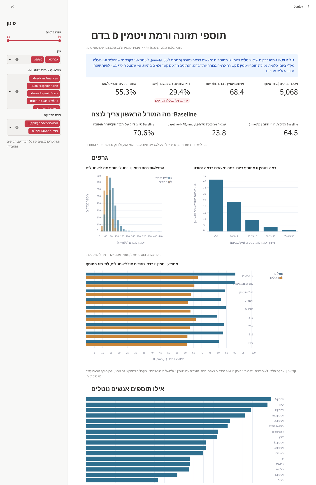

<!-- הדביקי את הסעיפים האלה ב-README.md הראשי של הריפו, מתחת למה שכבר כתוב שם -->

## תובנות מהדשבורד

1. **מינון תוסף קשור לרמה בדם.** 41% מהנבדקים שלא נוטלים ויטמין D מתוספים נמצאים ברמה נמוכה (מתחת ל-50 nmol/L), לעומת 9% בקרב מי שנוטלים 10–25 מק"ג ביום, ופחות מ-2% בקרב מי שנוטלים 50 מק"ג ומעלה.
2. **הבדלי מוצא גדולים.** 51% מהנבדקים ממוצא Non-Hispanic Black נמצאים ברמה נמוכה, לעומת 13% ממוצא Non-Hispanic White. כלומר, "כולם צריכים אותו הדבר" לא נכון, וזו סיבה טובה להתאמה אישית.
3. **רוב הנוטלים לא נוטלים תוסף ממוקד.** 55% נטלו תוסף כלשהו. מולטי-ויטמין הוא הנפוץ ביותר (1,159 נבדקים). פרוביוטיקה, מגנזיום וברזל נפוצים הרבה פחות, וקריאטין כמעט לא קיים בנתונים (11 נבדקים).

> הנתונים מראים קשר ולא סיבתיות. מי שנוטל תוסף עשוי להיות שונה גם בהרגלים אחרים.



## הרצה

```
pip install -r requirements.txt
streamlit run app.py
```

## צוות

| שם | תפקיד | GitHub |
|---|---|---|
| פולינה | איסוף וניקוי נתונים, Data Card | (ה-username שלך) |
| (שם) | (תפקיד) | (username) |
| (שם) | (תפקיד) | (username) |
